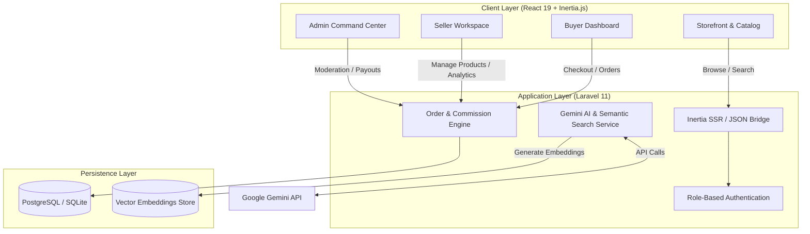

# Shopify — Multi-Vendor E-Commerce Platform & AI Marketplace

[](https://laravel.com/)
[](https://react.dev/)
[](https://inertiajs.com/)
[](https://tailwindcss.com/)
[](https://ai.google.dev/)
[](LICENSE)

A modern, full-stack multi-vendor e-commerce marketplace platform engineered with **Laravel 11**, **Inertia.js**, and **React 19**. Features role-based portals for Buyers, Sellers, and Admins, semantic vector search powered by **Google Gemini AI**, live order tracking pipelines, and interactive seller analytics.

---

## 🎬 Sneak Peek


> **Walkthrough highlights:**
> - High-impact animated intro loader with floating 3D e-commerce elements and cybernetic lighting.
> - Curated storefront with category carousels, featured product highlights, and responsive navigation.
> - Product catalog view with live filtering, dynamic sorting, and semantic search integration.
> - Role-based authentication portal providing seamless switching between Buyer, Seller, and Admin workspaces.

---

## ✨ System Features

### 🛍️ Customer Storefront & Buyer Portal
- **Modern Catalog Experience**: Browse products with instant category filtering, price range sorting, and brand highlights.
- **Smart AI Shopping Assistant**: Integrated conversational assistant powered by Google Gemini to help buyers find the perfect item based on natural language queries.
- **Cart & Dynamic Checkout**: Multi-item cart management, promo codes, multiple shipping addresses, and saved payment methods.
- **Order Tracking & Invoices**: Real-time order progress timeline (Pending → Processing → Shipped → Delivered) with downloadable order invoices.
- **Reviews & Ratings**: Verified customer ratings, feedback, and AI-powered sentiment summarization of product reviews.

### 🏪 Dedicated Seller Workspace
- **Vendor Onboarding**: Streamlined merchant registration with customizable shop profiles and branding.
- **Product Inventory Management**: Complete CRUD operations for products, SKU tracking, multi-image upload handling, and automated embedding generation.
- **Analytics & Revenue Dashboard**: Interactive revenue charts, sales velocity, average order values (AOV), and customer retention powered by Recharts.
- **Order Fulfillment**: Track vendor-specific order items, update tracking IDs, and manage split orders.
- **Payout Management**: Request payout withdrawals, monitor processing status, and track commission breakdowns.

### 🛡️ Admin Command Center
- **System Telemetry**: Global platform metrics, GMV (Gross Merchandise Volume), commission earnings, and active vendor counts.
- **Category & Taxonomy Management**: Multi-level hierarchical categories with custom imagery and slug management.
- **Vendor Moderation & Payout Approvals**: Review pending merchant payout requests, verify accounts, and manage platform safety.
- **Global Platform Settings**: Configurable platform commission rates, operational toggles, and feature flags.

### 🧠 Gemini AI & Vector Embeddings
- **Semantic Product Embeddings**: Generates high-dimensional vector embeddings for product titles and descriptions using Gemini's embedding model.
- **Natural Language Product Discovery**: Buyers can search by conceptual phrases (e.g., *"lightweight clothes for summer beach vacation"*) rather than exact keyword matches.
- **Automated Review Summaries**: Consolidates multiple customer reviews into concise pros-and-cons takeaways.

---

## 🏗️ Architecture & Data Flow



---

## 📁 Repository Structure

```
shopify/
├── app/
│   ├── Http/Controllers/       # Storefront, Buyer, Seller, and Admin controllers
│   ├── Models/                 # Eloquent models (Product, Shop, Order, Review, User, etc.)
│   └── Services/               # GeminiService and AIService for embeddings and search
├── config/                     # Application, database, authentication, and service configs
├── database/
│   ├── migrations/             # Schema definitions (users, shops, products, orders, payouts)
│   └── seeders/                # DemoDataSeeder, AdminSeeder for instant bootstrap
├── docs/
│   └── sneak-peek.gif          # Demonstration GIF
├── public/                     # Compiled assets, brand logos, product demo assets
├── resources/
│   ├── css/                    # Tailwind CSS configuration and base styles
│   ├── js/
│   │   ├── Components/         # Reusable UI components (IntroLoader, CategoryCombobox, etc.)
│   │   ├── Layouts/            # Storefront, Buyer, Seller, and Admin shell layouts
│   │   └── Pages/              # Inertia.js page components (Shop, Checkout, Dashboard, Admin)
│   └── views/                  # Root Blade application template and invoice layouts
├── routes/
│   ├── web.php                 # Core platform, buyer, seller, and storefront routes
│   └── auth.php                # Authentication routes
└── vite.config.js              # Vite bundler configuration with Laravel-Inertia plugin
```

---

## 🚀 Getting Started

### Prerequisites
- **PHP**: v8.2 or higher
- **Composer**: v2.x
- **Node.js**: v18.0 or higher
- **npm**: v9.0 or higher
- **Database**: PostgreSQL (recommended for pgvector) or SQLite (for local zero-config testing)

### Installation Steps

1. **Clone the repository:**
   ```bash
   git clone https://github.com/vkn-can-code/shopify.git
   cd shopify
   ```

2. **Install PHP Dependencies:**
   ```bash
   composer install
   ```

3. **Install & Build Frontend Assets:**
   ```bash
   npm install
   npm run build
   ```

4. **Environment Configuration:**
   Copy the example environment file and generate the application encryption key:
   ```bash
   cp .env.example .env
   php artisan key:generate
   ```

5. **Configure Database & AI Credentials:**
   Open `.env` and set your database connection and optional Gemini API key:
   ```env
   DB_CONNECTION=sqlite
   # Or for PostgreSQL:
   # DB_CONNECTION=pgsql
   # DB_HOST=127.0.0.1
   # DB_PORT=5432
   # DB_DATABASE=marketplace
   # DB_USERNAME=your_username
   # DB_PASSWORD=your_password

   # Google Gemini API Key (for Smart Search & Product Embeddings)
   GEMINI_API_KEY=your_gemini_api_key_here
   ```

6. **Run Migrations & Seed Sample Data:**
   ```bash
   php artisan migrate --seed
   ```
   *This seeds default categories, demo tech/fashion/home shops, products, and admin credentials.*

7. **Generate Semantic Embeddings (Optional):**
   ```bash
   php artisan products:embed
   ```

8. **Start the Development Servers:**
   ```bash
   # Terminal 1: Backend Server
   php artisan serve

   # Terminal 2: Frontend HMR (Vite)
   npm run dev
   ```
   Open your browser at `http://localhost:8000`.

---

## 🔑 Demo Accounts

After running `php artisan db:seed`, the following accounts are available for testing:

| Role | Email | Password |
| :--- | :--- | :--- |
| **Admin** | `admin@marketplace.com` | `password` |
| **Seller (Tech)** | `tech@seller.com` | `password` |
| **Seller (Fashion)**| `fashion@seller.com` | `password` |
| **Buyer** | `buyer@demo.com` | `password` |

---

## 👤 Creator

**Vivek K Nair**
- GitHub: [@vkn-can-code](https://github.com/vkn-can-code)
- LinkedIn: [Vivek K Nair](https://www.linkedin.com/in/vivek-k-nair-38bbb2383/)

---

## 📄 License

This software is open-sourced under the [MIT License](LICENSE).
